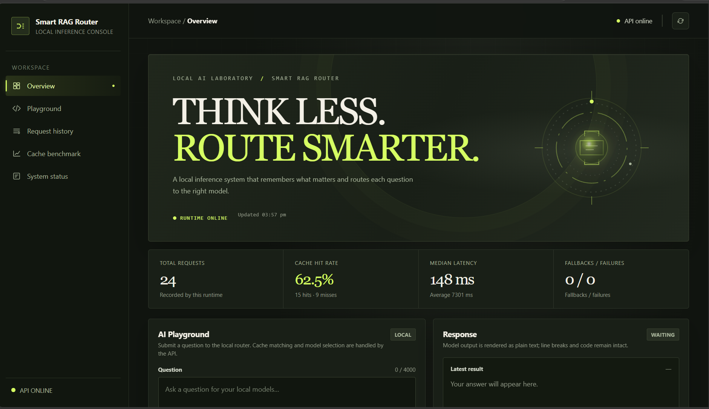
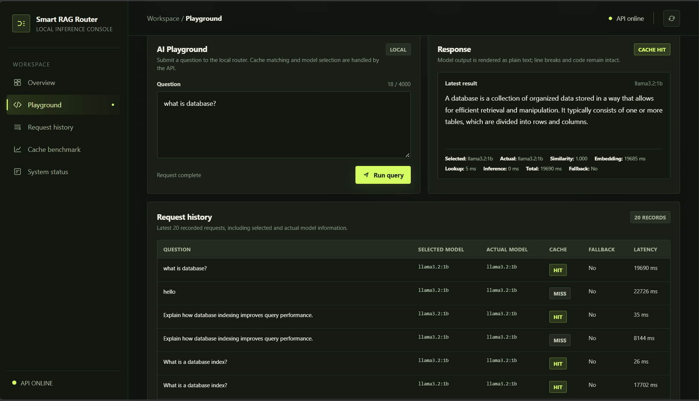
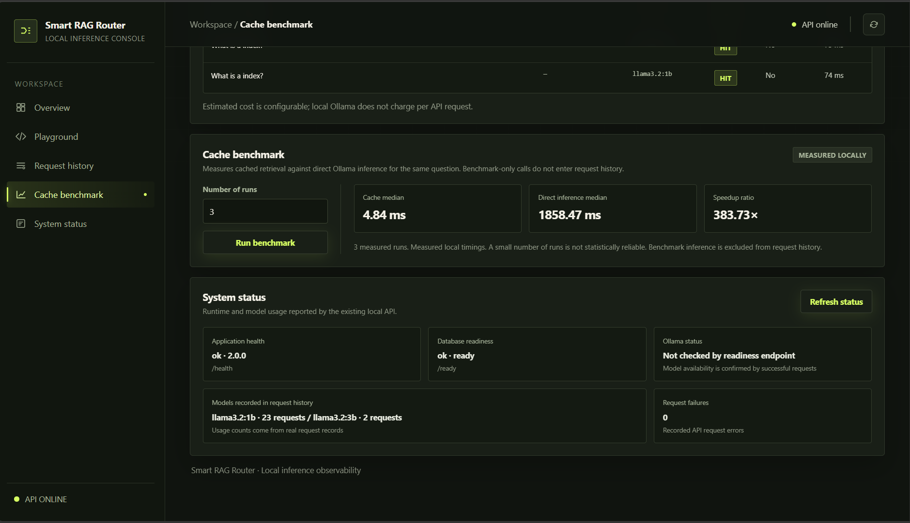

# Smart RAG Router

**A local-first question router that uses semantic caching and Ollama to choose and run a small or large language model.** It includes a FastAPI service, a browser dashboard, request history, operational metrics, and a cache-versus-inference benchmark.

> This is an educational MVP for local development. It does not ingest or search a document collection, and it is not presented as production-ready software.

## Problem

Repeated or similar questions can trigger repeated local model inference. Smart RAG Router explores two ways to manage those requests: reuse a stored answer when a new question is semantically similar, and select between configured local models using simple question-complexity heuristics. It records requests so cache behavior, model selection, fallbacks, and measured timings can be inspected.

## Features

- **Semantic caching:** Embeds each question and checks it against recent SQLite cache entries using cosine similarity.
- **Local inference:** Sends uncached questions to an Ollama model.
- **Heuristic model routing:** Selects between `llama3.2:1b` and `llama3.2:3b` by default, based on question signals.
- **Automatic fallback:** If the selected model call fails, tries the other configured model once.
- **Request history and metrics:** Records request outcomes and summarizes cache, latency, fallback, failure, model-use, and configured cost-estimate data.
- **Cache benchmark:** Compares measured cache lookups with direct model generation for the same question.
- **FastAPI dashboard:** Serves the single-page dashboard at `/`; no frontend build step is required.

## Architecture

```mermaid
flowchart LR
    U[Browser dashboard] -->|POST /api/ask| A[FastAPI app]
    U -->|metrics, history, health| A
    A --> E[Sentence Transformers embedder]
    E --> C{SQLite semantic cache\nsimilarity ≥ threshold?}
    C -->|HIT| R[Return stored answer]
    C -->|MISS| M[Heuristic model router]
    M --> O[Ollama selected model]
    O -->|request fails| F[Try other configured model once]
    O -->|answer| W[Write answer and request record]
    F -->|answer| W
    W --> R
    R --> U
    A <--> D[(SQLite history and cache)]
    U -->|POST /api/benchmark| B[Benchmark endpoint]
    B --> E
    E --> C
    C -->|No reusable entry| BM[Heuristic model router]
    C -->|Entry available| L[For each run: measure cache lookup]
    BM --> BO[Ollama selected model]
    BO -->|request fails| BF[Try configured fallback once]
    BO -->|Benchmark setup answer| P[Save cache entry only]
    BF -->|Benchmark setup answer| P
    P -->|No normal request-history record| L
    L -->|Then measure direct generation| DM[Heuristic model router per sample]
    DM --> DO[Ollama selected model]
    DO -->|request fails| DF[Try configured fallback once]
    DO -->|Sample answer and timing| L
    DF -->|Sample answer and timing| L
```



For `/api/ask`, the application embeds the question and scans at most the 5,000 newest cache entries. It returns the best matching saved answer when its cosine similarity reaches `CACHE_THRESHOLD` (default `0.88`). Otherwise, heuristic signals choose a model, Ollama generates an answer, and the successful answer is saved with its embedding. Request history is recorded in SQLite. The embedding model is loaded lazily on the first embedding request.

Despite the project name, this MVP implements semantic answer caching and model routing; it does not implement document upload, chunking, a document index, or retrieval-augmented generation over a private corpus.

## Technology stack

- Python 3.10+
- FastAPI and Uvicorn
- Pydantic request validation
- SQLite for local cache and request records
- Sentence Transformers (`sentence-transformers/all-MiniLM-L6-v2` by default) for embeddings
- Ollama for local text generation
- HTML, CSS, SVG, and vanilla JavaScript for the dashboard
- pytest and HTTPX in the project dependency list

## Project structure

```text
.
├── .env.example       # Safe example settings; no credentials
├── .gitignore         # Excludes local runtime and sensitive artifacts
├── README.md
├── app.py             # FastAPI app, routing, cache, metrics, benchmark
├── dashboard.html     # Dashboard served by FastAPI
├── requirements.txt
└── tests/
    └── test_app.py    # Isolated unit/API-logic tests
```

Local files such as `.venv/`, `.env`, SQLite databases, logs, and test caches are intentionally not part of this structure and should not be committed.

## Windows setup

Run these commands in PowerShell from the project directory. Python 3.10 or newer is required.

### 1. Create the virtual environment and install dependencies

```powershell
py -3 -m venv .venv
.\.venv\Scripts\python.exe -m pip install -r requirements.txt
```

### 2. Install Ollama and download the models

Install Ollama from [ollama.com/download](https://ollama.com/download), then start the Ollama application/service. In PowerShell, download both default models and confirm they are present:

```powershell
ollama pull llama3.2:1b
ollama pull llama3.2:3b
ollama list
```

The default router uses `llama3.2:1b` for simpler questions and `llama3.2:3b` when its complexity heuristics match. Both tags are required to exercise fallback in either direction. The application expects Ollama at `http://127.0.0.1:11434` unless `OLLAMA_URL` is changed.

### 3. Configure the application

The committed `.env.example` contains non-secret defaults. Copy it to `.env` for local use:

```powershell
Copy-Item .env.example .env
```

The application reads process environment variables; it does **not** automatically load `.env`. Load this simple `KEY=value` file into the current PowerShell session with:

```powershell
Get-Content .env | Where-Object { $_ -match '^[A-Za-z_][A-Za-z0-9_]*=' } | ForEach-Object {
    $name, $value = $_ -split '=', 2
    Set-Item -Path "Env:$name" -Value $value
}
```

The default database path is `rag_router.db` in the current working directory. To keep an existing database separate while trying the app, set a different path **before starting the server**:

```powershell
$env:DB_PATH = ".\local-test.db"
```

The embedding model is downloaded by Sentence Transformers on first use if it is not already available locally. That first load requires network access and may take time.

### 4. Start the application

```powershell
.\.venv\Scripts\python.exe -m uvicorn app:app --host 127.0.0.1 --port 8000
```

Open [http://127.0.0.1:8000](http://127.0.0.1:8000). The interactive API schema is at `/docs`. To stop a foreground development server, use `Ctrl+C`. Opening `dashboard.html` directly from disk is unsupported; the dashboard needs the FastAPI server for its same-origin API requests.

## Configuration reference

Settings are read from environment variables when `app.py` starts. Defaults below match the current code and `.env.example`.

| Variable | Default | Purpose |
| --- | --- | --- |
| `DB_PATH` | `rag_router.db` | SQLite file path. |
| `OLLAMA_URL` | `http://127.0.0.1:11434` | Ollama server base URL. |
| `SMALL_MODEL` | `llama3.2:1b` | Small model used by routing and as the other model's fallback. |
| `LARGE_MODEL` | `llama3.2:3b` | Large model used by routing and as the other model's fallback. |
| `EMBEDDING_MODEL` | `sentence-transformers/all-MiniLM-L6-v2` | Sentence Transformers embedding model. |
| `CACHE_THRESHOLD` | `0.88` | Cosine similarity threshold, from 0 to 1. |
| `REQUEST_TIMEOUT_SECONDS` | `120` | Ollama generation timeout. |
| `NUM_PREDICT` | `384` | `num_predict` passed to Ollama. |
| `OLLAMA_KEEP_ALIVE` | `5m` | Ollama model keep-alive value. |
| `MAX_CONCURRENT_INFERENCES` | `1` | Maximum simultaneous inference calls (minimum effective value is one). |
| `SMALL_MODEL_ESTIMATED_COST` | `0` | Optional per-request estimate recorded for the small model. |
| `LARGE_MODEL_ESTIMATED_COST` | `0` | Optional per-request estimate recorded for the large model. |

Cost values are configurable estimates; local Ollama does not charge a per-request API fee. The service has no authentication. Keep it bound to localhost and do not expose it to an untrusted network.

## API reference

FastAPI publishes interactive documentation at [`/docs`](http://127.0.0.1:8000/docs) and the schema at `/openapi.json` when the app is running.

| Method and route | Behavior |
| --- | --- |
| `GET /` | Serves `dashboard.html`. |
| `GET /health`, `GET /api/health` | Returns application name, version, and process status. |
| `GET /ready`, `GET /api/ready` | Checks whether SQLite can be queried. Does not check Ollama connectivity. |
| `POST /api/ask` | Validates a question, embeds it, looks up cache, routes and generates on a miss, then records the request. |
| `GET /api/history?limit=20` | Returns recent request records; `limit` must be 1–100. |
| `GET /api/metrics` | Returns aggregate request, cache, latency, fallback, failure, model-use, and estimated-cost data. |
| `POST /api/benchmark?runs=3` | Measures cache lookup and direct generation samples; `runs` must be 1–10. Uses the same question body as `/api/ask`. |

Question request body for `/api/ask` and `/api/benchmark`:

```json
{"question":"Explain how semantic caching works."}
```

Pydantic applies the question field's 3–4,000 character length constraints before the validator trims surrounding whitespace; whitespace-only questions are rejected, and accepted text is trimmed before processing. `/api/ask` responses include `answer`, `cache_hit`, `similarity`, `model`, `requested_model`, `fallback_used`, `routing`, timing fields, and `estimated_cost`. Embedding failures and model-generation failures are reported as HTTP 503. Custom `HTTPException` responses use the application's `{"error":{"message":...,"type":...}}` envelope; FastAPI request-body and query-parameter validation failures use its standard 422 validation response format.

`/api/history` returns an `items` array with question, selected/requested and actual model, cache status, latency, cost estimate, timestamp, fallback, stage timing, and error fields. `/api/metrics` aggregates records from this database; it does not represent externally collected or synthetic measurements.

## Cache behavior: HIT and MISS

- **HIT:** The question embedding has cosine similarity at or above `CACHE_THRESHOLD` with a saved entry. The stored answer is returned; Ollama generation is skipped for that request. The cache entry's hit counter and request history are updated.
- **MISS:** No recent entry reaches the threshold. The router selects a model and asks Ollama to generate a response. A successful answer and its embedding are saved for later matches.

The lookup scans at most the 5,000 newest cache rows, so lookup work grows with that bounded set. Embeddings and answers are stored in the local SQLite database. Similarity matching can return an answer to a related question even when wording differs; callers should review whether that behavior suits their use case.

## Benchmark methodology and limitations

`POST /api/benchmark` first embeds the question and makes sure a matching cache entry exists, generating one if necessary. For each requested run, it measures a cache lookup and a direct Ollama generation (including configured fallback behavior), then returns the samples, a median for each path, and their ratio. Benchmark-only generation is excluded from regular request history. The cache measurements are lookup timings, not a full browser-to-API response measurement.

No benchmark result is published here because timings depend on hardware, model loading, Ollama state, embedding warm-up, and run count. The response fields are named medians; the current implementation selects the middle sorted sample (the upper-middle sample for an even run count). Use several runs on the target machine and treat the result as a local comparison: the API allows at most 10 runs and explicitly notes that small samples are not statistically reliable. Benchmarking requires a working embedding model and Ollama models for direct inference.

## Dashboard screenshots

The following images are captures of the running dashboard. Displayed metrics and timings are specific to the captured local session and are not benchmark claims.

### Dashboard overview



*Overview of the local dashboard, including runtime status, session metrics, and the Playground entry point.*

### Playground response


*A real Playground interaction with the generated response and request details.*

### Semantic cache hit



*The supplied Playground capture also shows a cache hit, including its similarity and timing fields. This is the same original capture as `playground.png`, saved at both requested paths.*

### Cache benchmark



*A local benchmark result. Values vary by machine, model state, and run; they are shown as an example capture, not a reproducible performance claim.*

## Tests and compilation

Run the existing suite from the project directory:

```powershell
.\.venv\Scripts\python.exe -m pytest -q
```

If the default temporary directory is restricted, use this ignored in-project test directory:

```powershell
.\.venv\Scripts\python.exe -m pytest -q --basetemp=.pytest-tmp
```

Run Python compilation checks:

```powershell
.\.venv\Scripts\python.exe -m compileall -q app.py tests
```

The tests use an isolated temporary SQLite database and fake embedding/model behavior; they do not require a running Ollama service or verify a real model download. For a manual local smoke test, configure a separate `DB_PATH`, start Ollama and FastAPI, call `GET /ready`, submit a question to `POST /api/ask`, and repeat the question to inspect cache reuse.

## Known limitations

- Model routing is a small keyword/length heuristic, not a learned classifier or quality-based router.
- Semantic cache lookup is a linear scan of at most 5,000 recent SQLite entries; there is no vector database or cache eviction policy beyond that lookup limit.
- The project does not ingest, index, or retrieve user documents despite “RAG” in the name.
- The API has no authentication, user isolation, or rate limiting and is intended for local use.
- `/ready` checks SQLite only; Ollama availability is learned when generation is attempted.
- The benchmark is local and small-sample; its figures are machine- and model-state-dependent.
- Metrics and history are tied to one local SQLite database, and configured cost values are estimates only.

## Privacy and security

Questions, generated answers, embeddings, and request metadata are stored in the configured SQLite database. Ollama inference is local when using the default local endpoint, but the embedding model may be downloaded from its model source on first use. Keep private inputs and database files under appropriate local access controls. The API has no authentication and should remain bound to `127.0.0.1` unless access controls are added. Never commit `.env`, credentials, private keys, or databases. `.env.example` contains defaults only; review local configuration before sharing logs or screenshots.

## Future improvements

Potential directions, not implemented features:

- Add document ingestion and retrieval if the project is to provide full RAG behavior.
- Evaluate routing and cache thresholds against a documented local test set.
- Consider an indexed vector store if cache size or lookup time becomes a measured issue.
- Add authentication and request controls before any network-facing deployment.
- Add reproducible benchmark scripts and privacy-safe dashboard screenshots.

## License

No `LICENSE` file is currently included. The repository therefore has no explicit open-source license; do not assume that others may reuse or redistribute the code. Choose and add a license before inviting contributions or reuse.
